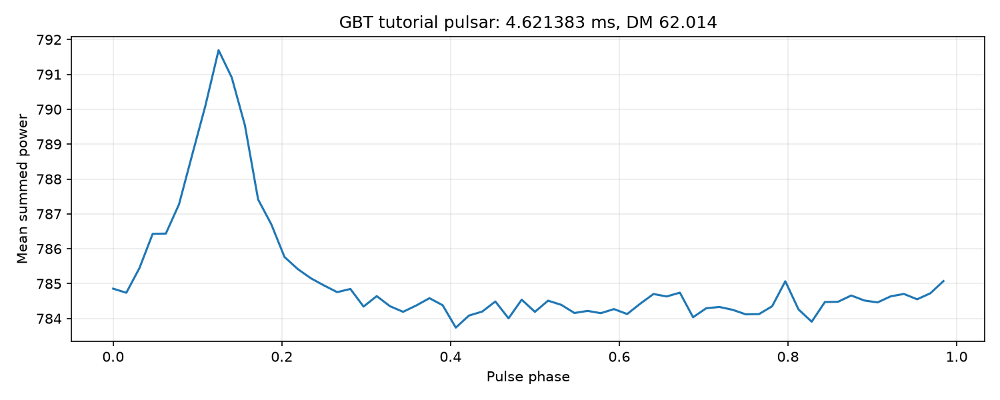
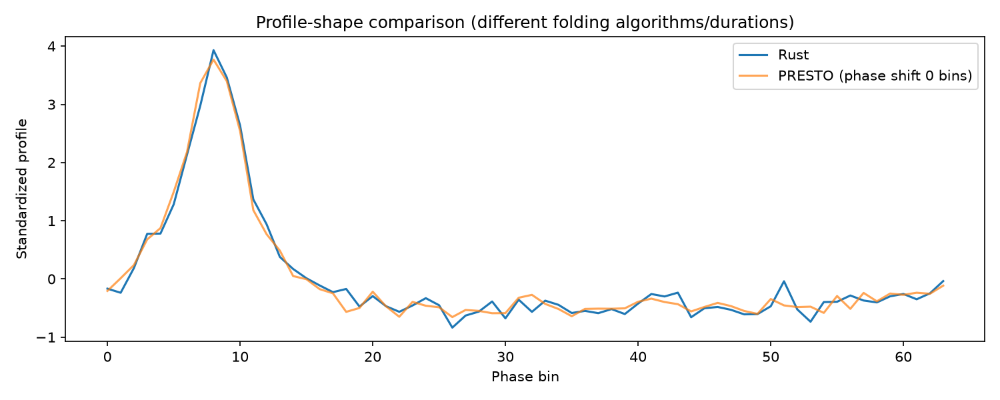
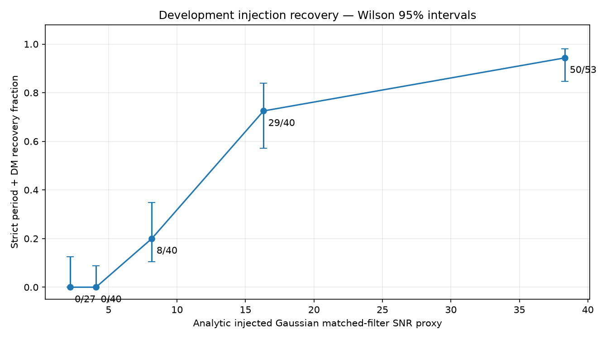

# PulsarSr

A Rust pulsar-search pipeline with SIGPROC filterbank input, verified on the PRESTO GBT tutorial observation.



**Implemented:** filterbank parsing, RFI masking, trial-DM dedispersion, FFT search, harmonic summing, candidate sifting, period/DM refinement, pulse-profile plots, seeded synthetic observations and a CLI.

The search now includes **split-data candidate confirmation**: discovery selects the period/DM/pulse window; separate data checks persistence and interference controls. The GBT pulsar is accepted and the leading interference rejected. Accepted candidates remain follow-up leads, not astrophysical proof. See [confirmation results and limitations](docs/confirmation.md).

### Burst-RFI fix

The mask's robust scale had a floor of 1% of the median, which on high-baseline data (about 100) exceeded the true scatter of block means and let a broadband burst through. The floor is now 0.01%. On the fresh seed set 60000 (`held-out-2`, never used for tuning), severe-RFI recovery is **20/32** with 1/32 observations holding an unmatched accepted lead, versus 20/32 and 2/32 in the clean-pulsar slice. Negatives remain 0/160 and the GBT result is unchanged. The first-pass v1 numbers below are kept for the record.

### Latest confirmation results

- GBT accepted: **4.621398 ms**, DM **62.389**, held-out pulse SNR **34.18**.
- **0/160** held-out noise/RFI-only observations had accepted candidates; the one-sided 95% upper bound is **1.86% per observation** for this limited control mixture.
- Strict injection recovery: **17/32 clean**, **16/32 colored**, **0/32 burst-RFI stress** (v1 baseline; fixed afterwards, see below), across varied strengths. Harmonic/DM errors and unmatched accepted leads remain in positive observations.
- **15 tests** pass, including independent bit-depth fixtures and end-to-end confirmation controls.

Historical full-data measurements below remain a separately recorded baseline. The latest split-data run uses less discovery data and different confirmation processing.

## Build and run

Requires stable Rust. Tested locally on Windows with Rust 1.97.1.

```sh
cargo build --release
cargo run --release --bin psr -- search GBT_Lband_PSR.fil --dm-max 500 --threads 8 --out output_gbt
```

Download [GBT_Lband_PSR.fil](https://www.cv.nrao.edu/~sransom/GBT_Lband_PSR.fil) into the project directory. It is about 25 MB. The default DM plan uses the actual sample time and bandwidth: approximately 0.250057 pc cm⁻³ steps, 2,000 trials over 0–500.

On Windows, the built binary is `target\release\psr.exe`; on Linux/macOS it is `target/release/psr`.

```sh
psr header GBT_Lband_PSR.fil
psr inspect GBT_Lband_PSR.fil --out output_inspect
psr dedisperse GBT_Lband_PSR.fil --dm 62 --out output_dm62
psr synth synthetic.fil --period 0.032 --dm 62 --amplitude 0.5 --seed 42
psr search synthetic.fil --dm-max 120 --dm-step 2 --min-hz 10 --threads 8 --out output_synth
psr search --help
```

`--dm-step 2` is a deliberately coarse, faster search; omit it for sample-time-limited spacing. `--max-samples` limits loaded data. `--birdie HZ:HALF_WIDTH_HZ` adds a spectral mask; repeat for multiple frequencies. `--no-rfi` disables masking. Zero-DM families are retained in diagnostics and tested by explicit confirmation vetoes. Changing settings affects sensitivity.

```sh
psr fold GBT_Lband_PSR.fil --period 0.004621398 --dm 62.389 --out output_fold
cargo run --release -p synth --example confirmation -- held-out reference/confirmation_held-out.json
python scripts/summarize_confirmation.py
```

## Outputs

- `header.json`: parsed header and derived reader fields
- `report.json`: schema 2, input checksum, available Git revision, settings, masks, timings, complete DM history, discovery/validation split, acceptance rules and rejection reasons
- `candidate_N_profile.png`, `candidate_N_dm.png`, `candidate_N_time.png`, `candidate_N_subbands.png`: discovery profile/full-range DM response and held-out persistence diagnostics
- `inspect`: `waterfall.png`, `dm0.png`
- `dedisperse`: little-endian `series.f32`, its metadata and `series.png`
- `synth`: 32-bit float filterbank and adjacent `*.truth.json`

Candidate numbering follows spectral ranking. **The tutorial pulsar is candidate #1 in the saved full run, not #0**; #0 is a strong ~28.76 Hz interference feature also present in PRESTO. The README plot deliberately selects the known tutorial target for comparison, without changing search rankings.

## Historical full-data baseline verification

The exact final measurements are in [`reference/evidence.json`](reference/evidence.json).

- Rust DM 62 raw channel-sum time series matches PRESTO 6.1.0 over **527,600 samples**, correlation **1.0**, with equal scaling and start alignment.
- Rust detects a period near **4.621383 ms**, DM **62.014**. PRESTO's independent topocentric folding result is **4.621376 ms**, DM **62.318**.
- The tutorial's **4.621638 ms** is an expected reference value, not an assertion that the unbarycentered observation must match it exactly.
- Development evaluation: **200 injections + 40 noise-only controls**, varying period, DM, duty cycle and strength. Above analytic injected SNR proxy 20, strict period/DM recovery is **50/53 (94.3%)**, Wilson 95% interval **84.6–98.1%**.
- At the exploratory spectral threshold of 8, **all 40 noise-only controls produced candidates**. This measures candidate generation, not confirmed pulsar false alarms; a calibrated final confirmation rule is unfinished.





## Historical full-data performance

Repeated Windows release measurements on Intel Core i7-14700HX (20 cores / 28 logical processors), same dataset, **251 coarse DM trials**, RFI enabled, top 2 folding, plots included:

| Threads | Median wall time, 3 repeats | Standard deviation |
| --- | --- | --- |
| 1 | 13.499 s | 0.259 s |
| 8 | 3.575 s | 0.019 s |

One warm-up was discarded per group. Candidate/profile results were identical across repeats and thread counts. This is **Rust thread scaling**, not a matched-workload speed comparison against PRESTO. The full 2,000-DM search took about 22.46 s in one saved run. See [`reference/benchmark.json`](reference/benchmark.json).

## How it works

1. Read a SIGPROC header and decode time-major payload into channel-major arrays.
2. Mask robust channel/block outliers, replacing samples with channel medians.
3. For each DM, shift each channel relative to the highest frequency and sum.
4. FFT, estimate local spectral background, sum 1/2/4/8/16 harmonics, and rank peaks.
5. Sift nearby-frequency and harmonic duplicates across DM trials, then fold/refine candidates.

Numerical stages operate on explicit arrays/configuration. `fbank` and `synth` handle file formats; the CLI handles paths, plotting and orchestration. DM trials run independently using Rayon, preserving channel reduction order.

```text
crates/
  fbank/       SIGPROC parser, mmap reader, float writer
  rfi/         channel/block masks and median helper
  dedisperse/  physical delays, trial plan, brute-force summation
  search/      FFT, normalization, harmonic sums, candidates/sifting
  fold/        profiles, flat-profile statistic, local refinement
  synth/       seeded Gaussian pulsars/noise, recovery example
  cli/         psr commands and PNG/JSON export
scripts/       PRESTO reference, plots, repeated timings
reference/     measured evidence, recovery results, benchmark records
docs/          verification and implementation write-up
```

## Tests and reproduction

```sh
cargo fmt --all -- --check
cargo clippy --workspace --all-targets -- -D warnings
cargo test --workspace
cargo run --release -p synth --example recovery -- reference/recovery.json
python scripts/benchmark.py
```

GitHub Actions is configured for Windows and Linux. A repository has not yet been published, so remote CI is not claimed as run.

PRESTO is installed locally under `reference/toolchain/presto` inside WSL Ubuntu. Reproduction scripts and commands are in [verification](docs/verification.md). Toolchains and raw binary artifacts are ignored by Git.

## Limitations / remaining plan

- SIGPROC `nifs=1`; 1/2/4/8/16-bit unsigned samples and 32-bit floats. Unknown header keywords, signed integer formats, and incomplete frames are rejected. Packed padding and frequency-table headers are not implemented.
- Incoherent integer-sample delays only; no subband/tree/GPU dedispersion, barycentering, acceleration search, PSRFITS or single-pulse search.
- RFI masking is conservative and is not `rfifind`-equivalent; local median normalization and scores differ from PRESTO. Low-DM rejection is a heuristic.
- Sifting may still merge unrelated harmonic families or keep spectral sidelobes. Split-confirm-v1 is empirically evaluated on a small control grid; it is not general false-alarm calibration and can reject broad/low-DM pulsars.
- Historical recovery uses reused development seeds. New split-confirmation evaluation uses fresh held-out seeds and noise/RFI stress slices; severe-RFI recovery was fixed on 2026-10-13 (0/32 to 20/32, see above). Remaining misses are very weak signals and low-DM/broad-pulse pulsars vetoed by the zero-DM rules. The template grid is narrow, and PRESTO recovery comparisons remain.
- Catalogue cross-check, exhaustive candidate-by-candidate explanations, optimized dedispersion, Criterion/flamegraph/hyperfine measurements and matched PRESTO timing are pending.

See [implementation write-up](docs/write-up.md) and the Obsidian project dashboard for progress.

## Next objectives

1. **Catalogue check (next):** confirm the GBT pulsar's identity and period against ATNF, with epoch and barycentric caveats.
2. **Publish:** push the repository and get remote CI (Windows and Linux) green.
3. **Low-DM sensitivity decision:** measure what relaxing the zero-DM contrast and dispersion-width rules gains versus the false-alarm cost, on fresh held-out seeds (base 80000 or later). No rule changes without a new held-out set.
4. **Full PRESTO comparison:** candidate-by-candidate differences and recovery under matched settings.
5. **Performance:** subband or tree dedispersion with equivalence tests against brute force, profiling, then matched-workload PRESTO timing before any speed claim.
6. **Stress slices:** narrower bursts, drifting RFI, fractional-sample delays and short periods.
7. **Optional extensions:** PSRFITS, single-pulse search, acceleration or GPU.
## References

- [PRESTO tutorial](https://www.cv.nrao.edu/~sransom/PRESTO_search_tutorial.pdf)
- [PRESTO maintained upstream](https://github.com/scottransom/presto)
- [ATNF catalogue](https://www.atnf.csiro.au/research/pulsar/psrcat/)
- Original: Parth Malik, *Pulsar Search in Rust — Project Plan*, October 3, 2026.

MIT license.

